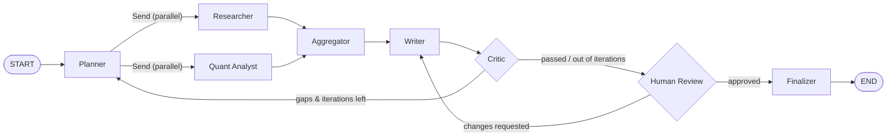

<div align="center">

# 🔎 Argus

**A self-correcting, multi-agent research assistant built on LangGraph and Gemini.**

Argus breaks a question into sub-questions, researches them in parallel, writes a cited report,
critiques its own draft, loops back to fill gaps, and asks you to approve the result before saving it.


</div>

---

## ✨ Features

- **Parallel research.** The planner fans sub-questions out to workers concurrently with LangGraph's `Send` API.
- **Specialised workers.** `researcher` handles qualitative questions with web search. `quant_analyst` writes and runs Python/pandas code for numeric ones.
- **Self-correction.** A critic node scores every draft for grounding, completeness, and citation coverage, then sends the graph back to the planner with targeted follow-up questions. The number of loops is capped.
- **Human-in-the-loop.** The graph pauses with `interrupt()` so you can approve the draft or ask for changes. Paused sessions are checkpointed to SQLite and can be resumed later, even from a new process.
- **Long-term memory.** A cross-session `Store` remembers what each user has researched.
- **Free-tier friendly.** Per-model rate limiting, automatic model fallback, and a disk cache keep the pipeline inside Gemini's free quota.
- **Structured output everywhere.** Every LLM boundary returns a Pydantic model, so routing decisions never depend on parsing free text.
- **Three interfaces.** A CLI, a streaming REST API (SSE), and a Streamlit web UI.

## 🧠 Architecture



| Node | Responsibility |
|---|---|
| `planner` | Breaks the question into up to *N* sub-questions, each tagged `research` or `quant`. On re-plans it targets only the critic's follow-up questions. |
| `researcher` | Searches the web with Tavily and writes a source-grounded answer. |
| `quant_analyst` | Generates a pandas script, runs it in an isolated subprocess, and summarises the output. |
| `aggregator` | Joins the parallel branches and compiles the findings into one context block. |
| `writer` | Produces a structured `ResearchReport` with numbered citations, or revises the draft based on feedback. |
| `critic` | Returns a `CritiqueResult` (passed, issues, follow-up questions, citation coverage). |
| `human_review` | Pauses for approval. Skipped when `auto_approve` is set. |
| `finalizer` | Saves the report to `outputs/` and records the topic in long-term memory. |

## 🚀 Quick Start

### 1. Prerequisites

- Python 3.10+
- A free **Gemini API key**: [Google AI Studio](https://aistudio.google.com/apikey)
- A free **Tavily API key** (1,000 searches/month): [app.tavily.com](https://app.tavily.com)

### 2. Install

```bash
git clone https://github.com/umangbagadi03/argus.git
cd argus
python3 -m venv .venv
source .venv/bin/activate          # Windows: .venv\Scripts\activate
pip install -r requirements.txt
pip install -e .
```

### 3. Configure

```bash
cp .env.example .env
```

Then open `.env` and add your keys:

```ini
GOOGLE_API_KEY=your-gemini-api-key
TAVILY_API_KEY=your-tavily-api-key
ARGUS_MAX_SUBQUESTIONS=3     # parallel sub-questions per planning pass
ARGUS_MAX_ITERATIONS=2       # max critic → planner self-correction loops
ARGUS_CHECKPOINT_DB=.data/checkpoints.sqlite
```

### 4. Run

**Web UI (recommended).** This starts the API and the UI together:

```bash
./run.sh
```

Then open **http://localhost:8501**.

**CLI**

```bash
# Start a session. It pauses for human review and prints a resume command.
argus "Compare LangGraph, CrewAI and AutoGen for production multi-agent systems"

# Approve, or request changes on, a paused session
argus --thread-id <thread-id> --resume-with "approve"
argus --thread-id <thread-id> --resume-with "Add a section on pricing"

# Fully unattended
argus --auto-approve "What are the trade-offs between RAG and long-context LLMs?"
```

**REST API**

```bash
uvicorn api.server:app --reload
```

| Method | Endpoint | Body | Description |
|---|---|---|---|
| `POST` | `/research` | `{"question", "user_id"?, "auto_approve"?}` | Starts a session and streams SSE events |
| `POST` | `/research/resume` | `{"thread_id", "feedback"}` | Resumes a paused session |
| `GET` | `/health` | – | Liveness check |

Stream events: `started` → `node_complete`* → `awaiting_human` \| `done` \| `error`.

## 🧪 Testing & Evaluation

The test suite runs fully offline. It uses a fake LLM and stubbed search, so no API keys are needed.

```bash
pytest
```

The evaluation harness runs the benchmark questions in `evaluation/eval_dataset.json` end to end. An LLM judge then scores how well each report covers the required points:

```bash
python evaluation/run_eval.py
```

## 📁 Project Structure

```
argus/
├── api/server.py              # FastAPI + SSE streaming server
├── ui/streamlit_app.py        # Streamlit web interface
├── src/argus/
│   ├── graph.py               # StateGraph assembly & routing
│   ├── state.py               # Shared graph state
│   ├── schemas.py             # Pydantic models for every LLM boundary
│   ├── llm.py                 # Rate-limited Gemini with fallback + cache
│   ├── memory.py              # Long-term memory helpers
│   ├── config.py              # Environment-driven settings
│   ├── main.py                # CLI entrypoint
│   ├── nodes/                 # planner, researcher, quant_analyst, aggregator,
│   │                          # writer, critic, human_review, finalizer
│   └── tools/                 # web_search (Tavily), code_exec (sandboxed subprocess)
├── evaluation/                # Benchmark dataset + eval harness
├── tests/                     # Offline pytest suite
└── run.sh                     # Starts API + UI together
```

## ⚠️ Notes

- **Code execution:** `quant_analyst` runs LLM-generated Python in a fresh isolated subprocess with a timeout. That is process isolation, not a security sandbox. Swap in E2B, Modal, or a gVisor container before exposing Argus to untrusted input.
- **Free-tier limits:** Gemini's free quotas change from time to time. Check the current values at [ai.google.dev/gemini-api/docs/rate-limits](https://ai.google.dev/gemini-api/docs/rate-limits) and adjust `DEFAULT_FALLBACK_CHAIN` in `llm.py` if needed.

## 👤 Author

**Umang Bagadi** · [@umangbagadi03](https://github.com/umangbagadi03)
